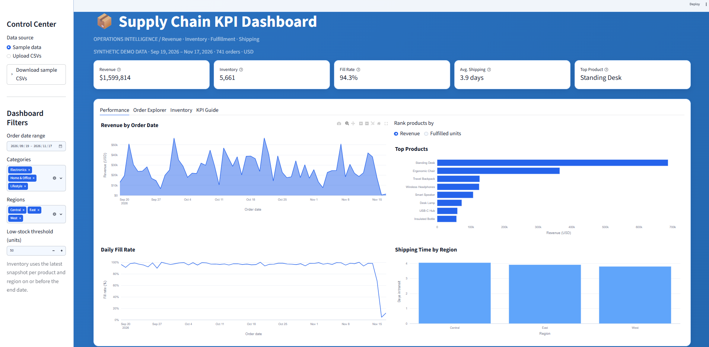

# Supply-Chain-KPI-Dashboard
An interactive supply chain analytics dashboard built with Streamlit, Plotly, and Pandas to track revenue, inventory, fill rate, shipping times, and top-performing products.

## Dashboard preview

